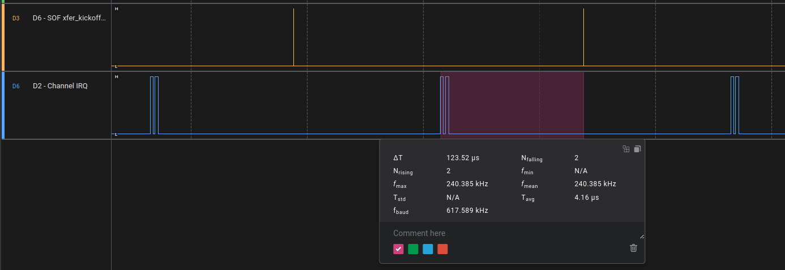
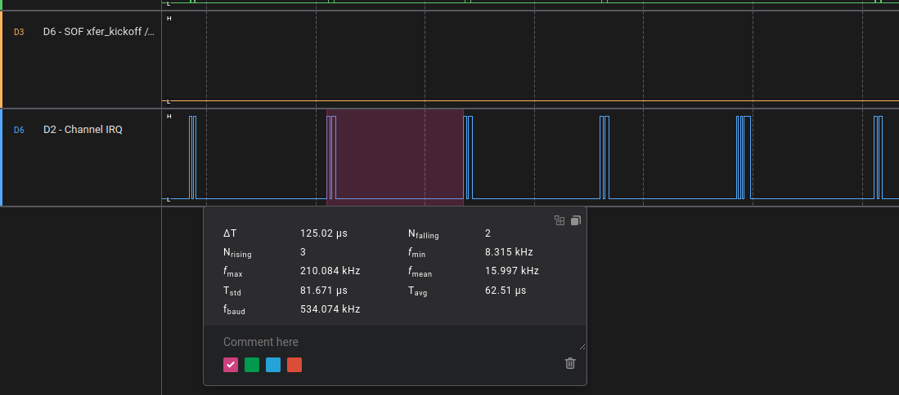

A high-speed USB device with an interrupt endpoint at `bInterval = 1` asks to be polled every microframe, so every 125 us. But with TinyUSB's DWC2 host driver, it got polled every 250 us. Only half the speed!

This is a write-up of fixes I sent upstream in April 2025. I was moving [XLAT](https://github.com/teamfinalmouse/xlat), Finalmouse's open source mouse latency tester, from ST's USB host stack to TinyUSB. XLAT measures the time between a mouse click, picked up electrically, and the USB packet that reports it. It runs on an STM32F7, and a tool that measures latency should not add its own. Many recent gaming mice run at 8 kHz polling rate, which is 125 us or `bInterval = 1` on USB High Speed.

## Finding the missing microframe

I toggled one GPIO in the channel interrupt and another one where the SOF handler kicks off a transfer, and put both on the logic analyser.

In the USB protocol, a device with nothing to report answers an IN token with a NAK. The driver handled that NAK by halting the channel, freeing it, enabling the SOF interrupt and starting a countdown. The next SOF then issued the IN token again, but by that time the microframe where the retry should have gone out was already gone.



The fix ([#3072](https://github.com/hathach/tinyusb/pull/3072)) is to retry straight from the channel interrupt when the endpoint wants every (micro)frame, targeting the next frame:

```c
if (edpt->uframe_interval == ucount) {
  // retry on next frame if bInterval is 1
  hcchar.odd_frame = 1 - (dwc2->hfnum & 1);
  channel->hcchar = hcchar.value;
  channel_send_in_token(dwc2, channel);
}
```

HiFiPhile, one of the maintainers, ran his own tests and found it was worse than I'd reported: every interval was polled one frame late, not only `bInterval = 1`. So the countdown for the other intervals became `uframe_interval - ucount`. His branch restarted the transfer with `channel_xfer_start()`, which got me `HCINT_DATATOGGLE_ERR`. That function updates the endpoint's saved PID, and a retry must leave the data toggle alone. hathach removed a flag that this change made obsolete, and merged it.



125.02 us between channel interrupts. That is what I wanted to see!

## The rest of the run

The frame itself was a bit long too. HFIR holds the number of PHY clocks per frame, and the driver wrote `125*phy_clock` for high speed (and `1000*phy_clock` for full speed). The Linux dwc2 driver subtracts one, and a 2016 linux-rpi-kernel mailing list post says the Synopsys databook was corrected in version 3.30a. With a 60 MHz PHY clock that is 7500 instead of 7499, so every microframe ran about 17 ns long ([#3074](https://github.com/hathach/tinyusb/pull/3074)). HiFiPhile checked his copy of databook 4.20a, and it still doesn't have the `- 1`. I don't have access to the databook, so I can't tell you what the other versions say.

The other three were robustness fixes. `handle_sof_irq()` never cleared the SOF flag, so in some cases (connecting a hub, for one) the interrupt kept firing forever ([#3063](https://github.com/hathach/tinyusb/pull/3063)). Unplugging a device produced no remove event, because the disconnect interrupt was never enabled ([#3067](https://github.com/hathach/tinyusb/pull/3067)). And contact bounce on plug-in made the port interrupt fire repeatedly. Every one of those turned into an attach event, which filled the event queue and crashed enumeration halfway. Now the first attach blocks further attach and remove events until the stack's debounce delay is over ([#3075](https://github.com/hathach/tinyusb/pull/3075)). hathach plans to move that into the generic host layer later, so other host controllers get it too. Repeatedly plugging into a hub port can still run out of channels, which deserves its own PR.

The maintainers were quick and they tested on their own hardware (an ESP32-S3 and an STM32H7RS) before merging, which helped. The issue with the first captures is [#3071](https://github.com/hathach/tinyusb/issues/3071).

## Conclusion

TinyUSB is awesome and it's maintainers are quick and great to work with!
