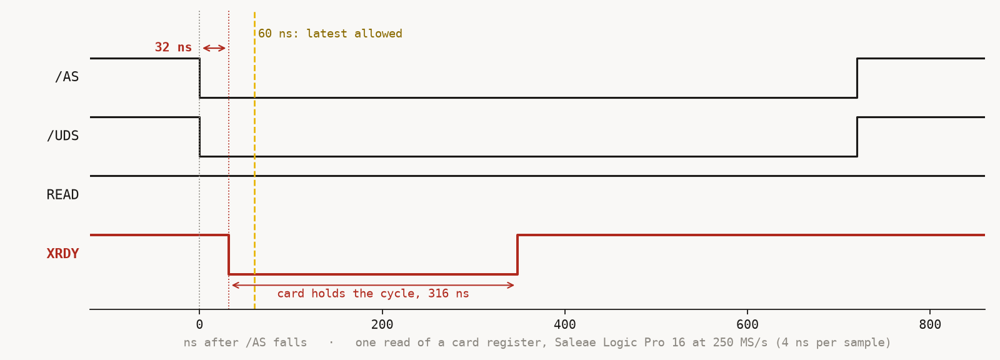
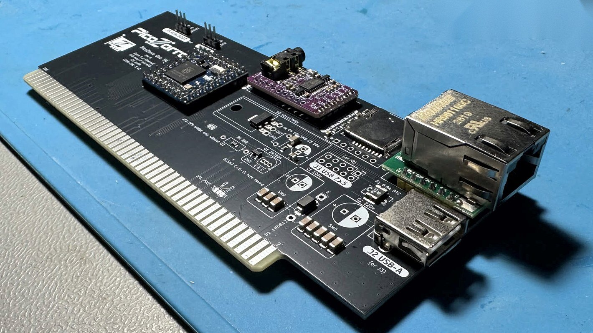
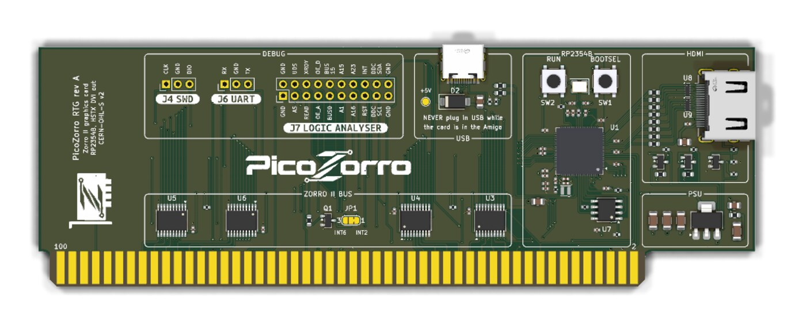
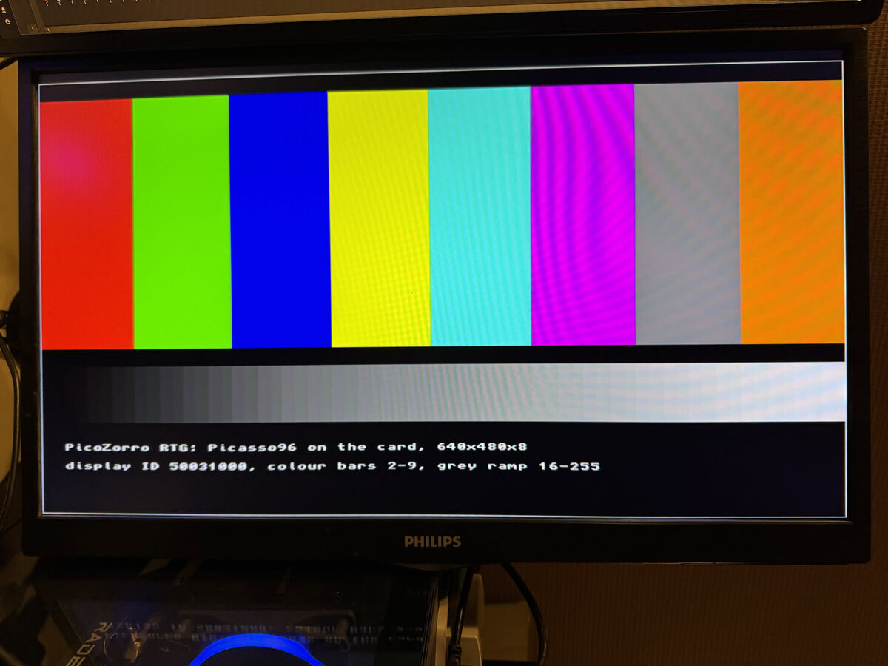

## Zorro II in one minute

Zorro II is the Amiga's expansion bus: the slots in an Amiga 2000 where the network cards, hard disk controllers and graphics cards go. It is to the Amiga what ISA, and later PCI, were to the PC.

Electrically it is close to ISA. It is more or less the 68000's own bus on a 100-pin card edge, with 24 address lines, 16 data lines and a clock of about 7 MHz. In spirit it is closer to PCI. A Zorro card has no jumpers and no address switches. At boot it introduces itself, the OS gives it an address, and that is that. Commodore called it Autoconfig, and shipped it in 1987.

So a card has two jobs: do Autoconfig properly, and answer the CPU's bus cycles in time. The second one is where it gets interesting.

## The 60 ns bet

A Zorro II card that needs more time has to say so by pulling a line called XRDY low within 60 ns of /AS falling. Gary, the chip that generates /DTACK on an A500-class board, asserts it within 45 ns, so a late card has to drag it back. That is the whole bet behind PicoZorro: a microcontroller, no CPLD, no FPGA, no level shifters, sitting directly on the bus and winning that race.

I wanted a network card for my [Denise](https://www.enterlogic.se/?page_id=180), a mini-ITX A500+ compatible board with two Zorro II slots. The usual recipe is an Ethernet chip plus a CPLD. I skipped that route: CPLDs cost more than they should, are not always easy to get, and usually bring a row of level shifters along. I also just like having fewer parts. So here an RP2350B does it: PIO state machines watch the bus, grab XRDY, and hold the cycle while the firmware fetches the data. The firmware is Rust on [Embassy](https://embassy.dev).



That is one real read, straight from the logic analyser. The card grabs XRDY 32 ns after /AS, holds the CPU for about 300 ns while the firmware finds the answer, and lets go.

## First contact

The RP2350's GPIO0-39 are 5 V tolerant, but only while the chip's own 3.3 V is up. So before the card went near a slot, I put the Saleae's analog channels on the Denise's Zorro +5 V. It takes about 1 ms to go from 2.3 V to 3.63 V. The module's regulator, hit with a hard 5 V step, reaches 3 V in about 50 us. 20x margin.

The first carrier board arrived on 2 October 2026. I flashed the firmware I had been test-driving on a devboard, but without a real Zorro bus, booted up the Amiga and...
the card came up!

```
17:14:41 waiting for /BUSRST, unconfigured, base $000000, resets 1, rd 0, wr 0
17:15:38 armed, unconfigured, base $000000, resets 1, rd 0, wr 0
17:15:41 armed, configured, base $ea0000, resets 1, rd 384, wr 2
```

That last line is Autoconfig doing its thing! SysInfo listed `$00EA0000 128K ZORRO II`. `pztest` then hammered the scratch register: 6.58 million write/read pairs, 0 errors. Sweet!

On the scope, /AS to XRDY was 48 ns (max 52) at 150 MHz. Too close for comfort. With the pico at 240 MHz and 1.15 V it is 34 ns, 36 ns worst case over about 325 000 cycles. Great.

## PicoZorro One TH



The first real card is built from off-the-shelf modules (Core2350B, a W5500 "Lite", an optional PCM5102 DAC) plus a handful of through-hole parts, so anyone with a soldering iron can make one. Or let JLCPCB place SMD alternates on the same board. On the Amiga side you get a SANA-II driver for Ethernet, `picozorrousb.device` for Poseidon, `picozorrosd.device` for the microSD card (bootable), and an `mpega.library` that decodes MP3 on the card instead of the 68k. Kickstart loads the drivers from the card's boot ROM. Firmware updates go from the Amiga with `pzflash` into A/B flash slots.

So far, I have built the Rev A (SMD variant) and runs Ethernet, USB host and the microSD block device in an Amiga. The all-through-hole version has not been built yet.

## Rev A and the A2000

That Amiga was the Denise. Then I put the card in a real A2000, and it did not show up at all. The firmware log told the story: Kickstart read the card's config area 68 times and never wrote an address back.

The Denise is forgiving here, the A2000 is not. An A2000 has data bus buffers between the CPU and the slots, and on a read they only turn towards the CPU while a card pulls a line called /SLAVE low. Rev A leaves /SLAVE unconnected. I had run out of 5 V tolerant pins, and the Denise does not need it. So the card answered just fine, and the 68000 read its own bus instead.

Two fixes were needed:

- **Hardware:** a wire from GPIO39 to edge pin 9, which is /SLAVE. That pin was the W5500's interrupt line, so that has to come off.
- **Firmware:** the PIO program now pulls /SLAVE low from the address match until /AS rises, open drain. With its interrupt pin gone, the W5500 is polled instead.

The spec wants /SLAVE low within 35 ns of /AS falling and released within 50 ns of /AS rising. Measured in the A2000: 24 to 32 ns, and 32 to 40 ns. With that, the card configures at `$EA0000` and the A2000 boots Workbench from the microSD. It is one firmware image for every Zorro II machine now.

So if you build a rev A for an A2000, it needs that one bodge wire. The next board revision gets a proper trace.

## Where it stands

A good part of the firmware was done by AI coding agents. I wrote the plans for and with Claude, the agents wrote the code one work package at a time, and I sat at the bench with the J-Link and the Saleae, reasoning at the results we got back.

Everything is open: firmware and Amiga software GPL-3.0, hardware CERN-OHL-S. Releases come with a ready UF2 and the Amiga package. Still missing: a driver for the I2S DAC, which does not play a note yet. TBD!

Code, KiCad files and docs: [github.com/maximevince/PicoZorro](https://github.com/maximevince/PicoZorro)

## Next up: PicoZorro RTG

If a microcontroller can keep up with the bus, it can also be a graphics card. An RTG card capable of 720p is coming up next. It will be made public soon, after extensive testing.



The firmware drew its first picture on a dev board, weeks before the card existed:


